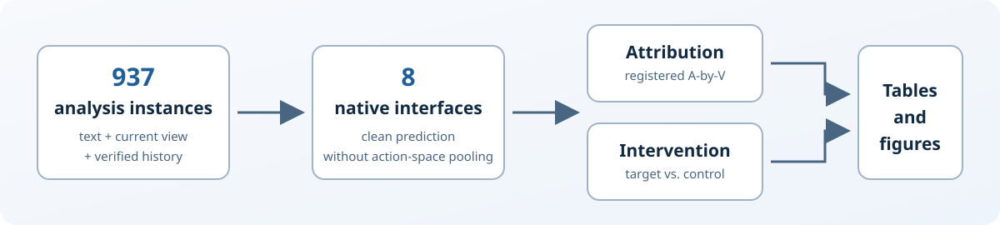
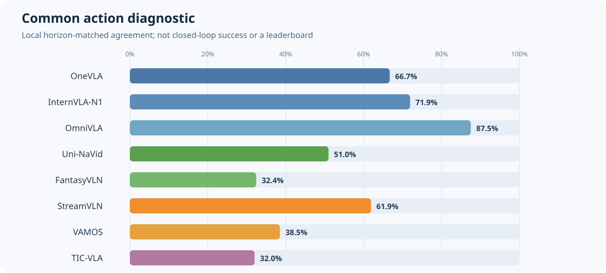

# LandMarkVLN

Reproducibility artifact for auditing whether navigation VLA models localize
and causally use the landmark named by an instruction.



## Frozen experiment

| Component | Frozen scope |
|---|---:|
| Analysis instances | 937 |
| Navigation VLA models | 8 |
| Policy--instance records | 7,496 |
| Attribution panels | 180 |
| Registered causal scopes | 20 |

The analysis-set membership was fixed before inspecting any evaluated-model
output. All models process the same 937 instances, while retaining their native
action representations and response metrics.

## Quick start

Only Python 3.10 or newer is required for the frozen-output checks.

```bash
make verify
make reproduce-analysis
```

These commands verify the frozen files, recompute the common action diagnostic
and registered A-by-V and model-native causal point estimates, and regenerate
the README summary:



The common action diagnostic is a local, horizon-matched agreement measure. It
is not native closed-loop navigation success and must not be interpreted as a
model leaderboard.

To create the deterministic, history-free review archive:

```bash
make artifact
```

The resulting ZIP is written under `dist/`. The builder uses an explicit
allowlist, verifies frozen checksums, audits text and compressed content for
identity-bearing paths or credentials, and records the archive checksum.

## What is included

- Analysis-ready frozen outputs for all eight models.
- Deterministic integrity and cross-model membership checks.
- CPU-only reconstruction of registered A-by-V and model-native causal point
  estimates.
- Reproducible README visualizations generated from frozen outputs.
- An anonymized supplementary-archive builder.

The full GPU inference environments, model weights, Matterport3D imagery, and
upstream R2R/RxR assets are not redistributed. The model-specific runners and
complete resampling pipeline are being admitted only after portability,
licensing, and anonymity checks; see `PROVENANCE_INVENTORY.md` for the current
boundary.

## Repository layout

```text
artifacts/frozen/       analysis-ready immutable inputs
artifacts/reproduced/   locally regenerated summaries (not committed)
assets/readme/          README visualizations
configs/                registered analysis configuration
scripts/                verification, analysis, visualization, archive tools
tests/                  structural and numerical regression tests
```

## Scientific boundaries

- `A` is a common local action diagnostic, not episode success or SPL.
- `V` is a registered matched-null attribution detection, not proof of causal
  use and not human pixel ground truth.
- Causal magnitudes stay in each model's native output units and are never
  pooled or ranked across incompatible action spaces.
- Current-only models have memory and combined scopes marked structural N/A,
  never zero.
- Uncertainty estimation groups observations that share a replay identity.

See `REPRODUCIBILITY.md` for commands and `DATA_CARD.md` for data scope and
limitations.

